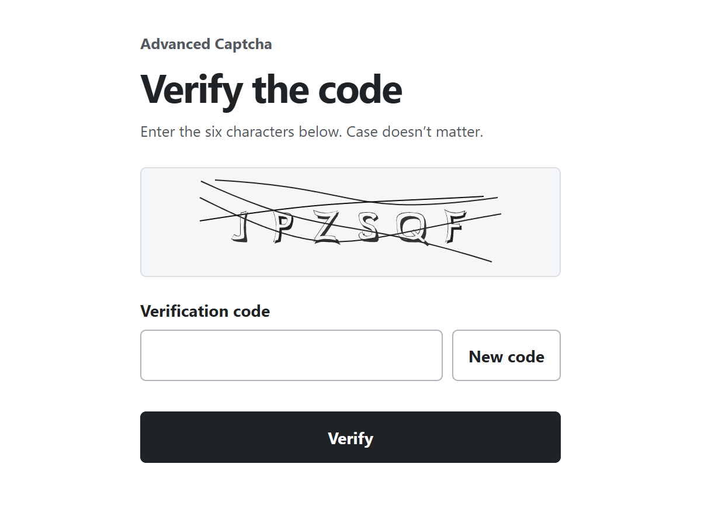

# Advanced Captcha

A self-hosted CAPTCHA verification demo for developers building and testing server-side bot controls with Express.

[Türkçe özet](#türkçe)



## What it does

- Generates a six-character CAPTCHA on the server and binds it to a signed, HttpOnly session cookie. Each code expires in two minutes, allows five wrong answers, and is consumed on success.
- Limits challenge generation and verification separately by session and IP. A global rate limit also caps challenge generation.
- Uses a honeypot and recent request patterns to flag automation. A flagged session may have to solve a second challenge.
- Supports optional Cloudflare Turnstile validation on the server. Local mode works without contacting Turnstile.

## Quick start

**Requirements** · Node.js 22 or newer and npm.

```sh
npm ci
npm start
```

Open [http://127.0.0.1:3000](http://127.0.0.1:3000/).

## Usage

Enter the six characters shown and select **Verify**. A correct answer shows **Verification complete**. Select **New code** to load another challenge. Three wrong answers followed by the correct answer demonstrate the additional verification step.

## Configuration

| Setting | Purpose | Default or requirement |
| --- | --- | --- |
| `HOST` | Bind address | `127.0.0.1` |
| `PORT` | HTTP port | `3000` |
| `APP_ORIGIN` | Canonical public origin without a trailing slash | Required in production and when using Turnstile |
| `TURNSTILE_SITE_KEY` | Public widget key | Optional, used with the secret key |
| `TURNSTILE_SECRET_KEY` | Server-side validation key | Optional, kept on the server |

Use an HTTPS origin with `NODE_ENV=production`. The HTTPS proxy terminates TLS and the app issues a Secure, host-only cookie. Configure IP limits at the proxy if it is the app’s direct peer. When enabled, Turnstile validates the token against the expected hostname, verification action, and challenge identifier. [Turnstile server-side validation](https://developers.cloudflare.com/turnstile/get-started/server-side-validation/)

## Tests

```sh
npm test
```

The suite covers session binding, expiry, one-time use, rate limits, additional verification, and the Turnstile integration with a simulated provider.

## Project status

**Demo** · Challenge and rate-limit state live in one Node.js process. A restart clears that state. For multiple instances, use shared storage with atomic challenge consumption and attempt counting. The visual puzzle supports keyboard controls and announces status updates. An audio alternative is outside the demo.

## Türkçe

Advanced Captcha, güvenlik kodunu sunucuda üreten ve doğrulayan bir Express demosu. Node.js 22 veya üzeriyle `npm ci`, ardından `npm start` çalıştır. Kod oturuma bağlıdır, iki dakika geçerlidir ve beş yanlış deneme hakkı vardır. Şüpheli tekrarlarda ikinci bir kod istenebilir. Cloudflare Turnstile isteğe bağlıdır.

## License

[CC BY-NC-SA 4.0](LICENSE)

---

Built by [**@egalgorix**](https://github.com/egalgorix)
